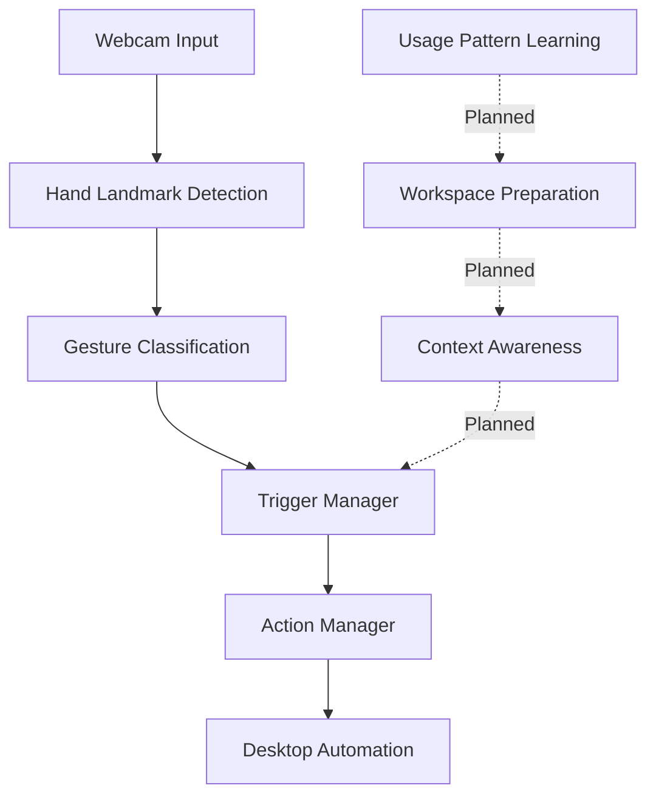

# GesturePC

### Context-Aware Gesture-Controlled PC Automation


<p align="center">
  <strong>Prediction prepares. Gestures execute.</strong>
</p>

<p align="center">
  Control your desktop with hand gestures. Build toward intelligent workflows that understand context, anticipate your needs, and prepare your workspace before you need it.
</p>

<p align="center">
  
  
  
  
  
</p>

---


---

## Overview

What if you could interact with your computer without constantly reaching for your mouse or keyboard?

**GesturePC** is a computer vision-based desktop automation project that uses real-time hand gestures to control computer interactions. Its long-term goal is to go beyond individual gesture-triggered actions by combining gesture-driven execution with context awareness and predictive workspace preparation.

Imagine preparing your development environment, switching between applications, or organizing your desktop through intuitive hand movements — with the system adapting its actions to the task at hand.

The guiding principle is simple:

> **Prediction prepares. Gestures execute.**

The system should anticipate what you might need, prepare the relevant workspace, and leave execution under your control.

## Features

### Implemented

- **Real-time hand tracking** — Detect and track hand landmarks through a webcam using MediaPipe.
- **Gesture recognition** — Recognize supported hand poses and directional swipes.
- **Desktop automation** — Trigger Windows keyboard shortcuts through hand gestures.
- **Gesture-controlled mouse** — Move the cursor using the index fingertip while the Pinch gesture is active.
- **Click-and-drag interaction** — Transition from Pinch to Click State to hold the left mouse button while moving the cursor.
- **Modular architecture** — Separate gesture recognition, trigger handling, and desktop action execution into dedicated components.

### Planned

- **Context-aware workflows** — Trigger multi-step actions based on the active application and desktop state.
- **Predictive workspace preparation** — Learn usage patterns and anticipate which applications, files, and tools may be needed.
- **Intelligent workflow orchestration** — Connect individual gestures to useful, context-dependent sequences of actions.
- **Accidental-action safeguards** — Add confidence checks, deliberate activation, and reliable recovery mechanisms.

*The planned features are part of the project's direction and are not yet implemented.*

## How It Works

GesturePC currently follows a modular processing pipeline:



1. **Perception:** Capture webcam frames and detect hand landmarks.
2. **Recognition:** Classify hand poses and detect swipe movements.
3. **Triggering:** Determine when a recognized gesture should activate an action.
4. **Execution:** Perform the corresponding desktop operation.
5. **Future intelligence:** Incorporate application context and learned usage patterns to prepare relevant workflows.

## Gesture Controls

The following table describes the intended gesture mappings. Confirm each mapping against your current local configuration, as gesture recognition and action bindings may evolve during development.

| Gesture     | Intended action                        |
| ----------- | -------------------------------------- |
| Swipe Left  | Snap active window to the left         |
| Swipe Right | Snap active window to the right        |
| Swipe Down  | Minimize windows                       |
| Swipe Up    | Restore minimized windows              |
| Peace Sign  | Switch applications                    |
| Thumbs Up   | Toggle media playback                  |
| Pinch       | Activate or deactivate mouse mode      |
| Click State | Hold the left mouse button after Pinch |
| Closed Fist | Toggle the emergency stop              |

**Mouse interaction:** Activate mouse mode, enter Pinch to move the cursor, then transition to Click State to hold the left mouse button and drag. Return to Pinch to release the button.

Gesture detection depends on camera visibility, hand orientation, and tracking quality. Some mappings may require additional integration or testing.

## Tech Stack

| Technology      | Purpose                                   |
| --------------- | ----------------------------------------- |
| Python          | Core application logic                    |
| OpenCV          | Webcam capture and visual feedback        |
| MediaPipe Hands | Hand landmark detection                   |
| PyAutoGUI       | Mouse and keyboard automation             |
| Git & GitHub    | Version control and project collaboration |

## Getting Started

### Prerequisites

- Windows 10 or Windows 11
- Python 3.10 or a compatible version supported by your installed dependencies
- A working webcam
- Git

### 1. Clone the repository

```bash
git clone https://github.com/aarkie24/GesturePC.git
cd GesturePC
```

### 2. Create a virtual environment

```bash
python -m venv .venv
```

Activate it on Windows:

```powershell
.venv\Scripts\activate
```

### 3. Install dependencies

```bash
pip install opencv-python mediapipe pyautogui
```

If your project uses additional dependencies or pinned versions, install those as well.

### 4. Run the application

```bash
python gesture_recognition.py
```

Make sure the required Python files are in the same project directory and that the imports match their filenames.

Press **Q** in the webcam window to exit.

## Project Structure

```text
GesturePC/
├── gesture_recognition.py   # Hand tracking and gesture classification
├── gesture_trigger.py       # Gesture trigger and cooldown handling
├── actionManager.py          # Desktop actions and mouse interaction
├── README.md
└── .gitignore
```

*The structure above reflects the current modular implementation; update it as the repository evolves.*

## Development Roadmap

- [x] Webcam-based hand landmark detection
- [x] Initial gesture classification
- [x] Swipe-based desktop controls
- [x] Initial cursor movement and click-and-drag logic
- [ ] Improve gesture reliability and transition handling
- [ ] Add context-aware, multi-step workflows
- [ ] Detect relevant application and desktop context
- [ ] Learn recurring computer usage patterns
- [ ] Prepare the workspace based on predicted needs
- [ ] Add safeguards, recovery paths, and workflow feedback

## Design Philosophy

GesturePC is being developed around three principles:

**1. Gestures remain the primary control mechanism.**
The user should decide when an action is executed instead of having the system unexpectedly take over.

**2. Context makes automation useful.**
The same gesture should eventually be able to trigger different workflows depending on the active application and current task.

**3. Prediction should prepare, not take control.**
Learning usage patterns should help arrange the necessary workspace in advance while keeping important actions predictable and user-directed.

## Current Limitations

- Recognition accuracy can vary with lighting, camera quality, hand orientation, and motion blur.
- Gesture classification currently relies on geometric landmark rules rather than a dedicated trained classifier.
- Context-aware workflows and predictive workspace preparation are planned capabilities.
- Desktop automation is currently designed around Windows keyboard shortcuts and mouse interaction.

## Contributing

GesturePC is an evolving project. Suggestions, bug reports, and ideas for improving gesture recognition, desktop automation, and context-aware workflows are welcome.

If you encounter an issue, include the steps to reproduce it, the gesture involved, and any relevant console output.


---

\<p align="center">
&#x20; \<strong>GesturePC\</strong>\<br/>
&#x20; \<em>From recognizing gestures to anticipating workflows.\</em>
\</p>
